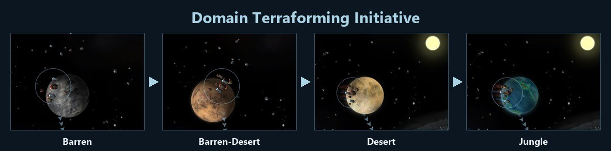
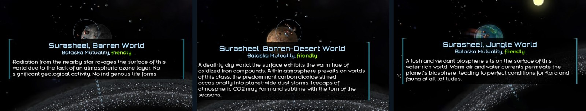

# Domain Terraforming Initiative

A Starsector 0.98a mod. Terraforming is a megaproject: you build a Terraforming Control on a colony, then run long projects that change the world's conditions and, in the end, its planet type.

**This is a test version.** It has every terraforming structure, but not the quests yet. Please report bugs and ideas in the [issues](https://github.com/RSRaven/domain-terraforming-initiative/issues) or in the [forum thread](https://fractalsoftworks.com/forum/index.php?topic=36308.0).

## What it adds

- **The Terraforming Control and 24 terraforming structures.** Each one works on one thing: toxic, dense, thin or no atmosphere; heat and cold; poor light and darkness; tectonic activity; extreme weather; pollution; an inimical biosphere; radiation. Others bring water with comets or take it away, improve the soil, seed marine life, or make a mild climate. When the conditions change enough, the planet changes its type.
- **Reverse projects:** the Atmospheric Siphon, the Deep Core Extractor and the Volatiles Extractor take resources from a world, at a price.
- **Colony Development:** Civic Integration, Labor Camps and the Purge Detachment work on the colony's people. Domed Cities (Sky Cities on a gas giant, Seafloor Cities on a water world), the City Agrav Grid and the Impact Defense Grid protect a colony from its hazards. Hydroponic Farms feed a colony that has no farmland.
- **24 special items** that make projects faster or cheaper. They wear out.
- **Projects take goods.** A short supply stops a project, and a long one makes it lose progress.
- **DTI Projects** in the Intel screen (Terraforming tag): every running project, by colony.
- **Planet history:** each planet with a Terraforming Control gets an entry in the same tab, with DTI's events and their dates. When a world changes its type, the entry shows the old and the new planet side by side. It stays when you lose the colony, and you can delete it.
- **Ecology events:** sometimes a long project gets an event with a choice, good or bad, and now and then a disaster. Crews that finished 3 projects of a structure know the work: fewer disasters, more good news, lower costs.
- **Eridani-Utopia contracts:** after your first terraforming project, an official of a faction that likes you can ask you at a bar to fix a condition of their world. Bring the goods, in parts if you like, and get paid when the last part arrives.
- **The Captive Sun** lights a dark world with a small star of its own.
- **Settings** in LunaLib: switch terraforming or Colony Development off, turn single kinds of projects off, and change the numbers.

## Pictures

Every structure with its picture and its game text, by group: [the Terraforming Control](forum/structures-01-terraforming-control.png), [atmosphere](forum/structures-02-atmosphere.png), [temperature](forum/structures-03-temperature.png), [light](forum/structures-04-light.png), [tectonics, weather, pollution, biosphere, radiation](forum/structures-05-tectonics.png), [water](forum/structures-06-water.png), [soil](forum/structures-07-soil-and-farmland.png), [marine life](forum/structures-08-marine-life.png), [climate](forum/structures-09-climate.png), [reverse projects](forum/structures-10-reverse-projects.png), [Colony Development](forum/structures-11-colony-development.png). And [the 24 items](forum/items.png).

## Requirements

- Starsector 0.98a
- [LunaLib](https://fractalsoftworks.com/forum/index.php?topic=25658.0)

Optional:
- **Ashes of the Domain (Vaults of Knowledge):** the structures come with research, on their own tab with 28 techs. The AoTD workshop can make our items.
- **MagicLib:** four achievements, two of them hidden.
- **Console Commands:** test commands `DTI_Unlock`, `DTI_Status`, `DTI_Progress`, `DTI_Short`, `DTI_Sun`, `DTI_Event` and `DTI_Contract`.

Tested with Nexerelin, AoTD, DIY Planets and TaSC.

## How to unlock the structures

The quests are not in the mod yet.
- **With AoTD:** research the techs on the DTI tab.
- **Without AoTD:** every structure is unlocked from the start. The LunaLib setting **Unlock without quests** (DTI, General tab) does this, and it is on by default until the quests are in the mod.

## Install

1. Unzip the folder into `Starsector/mods`.
2. Enable "Domain Terraforming Initiative" in the launcher (or in TriOS).

You can add DTI to a running game. It misses only the marine life that a new sector places on some water worlds; a Reef Seeder can still bring marine life to a water world.

You cannot remove DTI from a save. Once you save a game with DTI on, that save needs DTI to load, even if you never built or researched anything from it. Keep a copy of your save from before you add DTI.

## What comes next

The plan by version, with no dates. It can change, mostly from what you report.

- **0.5:** the DTI Planner in the Intel screen: pick a colony and a goal, and it queues the structures for you. It also shows what a planet you surveyed can become.
- **0.5.5:** a terraforming black market, a shop for DTI items.
- **0.6:** the hypershunt line, the planet creation line, and stations.
- **0.7:** the quests: the unlock paths and some hidden content.
- **0.8:** AI factions terraform their own worlds.
- **0.9:** AI raids on your research, and a smarter AI.
- **1.0:** the full release, after the last tests and bug fixes.

## Credits

Thanks to Alex and the Fractal Softworks team for building Starsector, a great game with the room for mods like this one.

Inspired by **DIY Planets** (kentington, now the community edition) and **Terraforming & Station Construction** (boggled). This mod takes ideas only: it has no code, text or art from them. The art was made for this mod; the pictures of the Stellar Shade and the Stellar Mirror in `forum/` are the base game's.

## AI use

- Art (building pictures, item icons, tech icons, and condition icons): Gemini Flash in the Gemini web app, Gemini 3.5 Flash.
- Texts: Claude Opus 5.5, as a text helper that helped proofread and fix issues in the texts.
- Code: Claude Opus 5.5, as a code helper that helped write most of the code and configs.

No extra training data was used.

## For modders

The Java source is in `src/`. To build `jars/dti.jar`, compile it for Java 8 with the game's jars, LunaLib, AoTD Vaults of Knowledge and Console Commands on the classpath.

## License

MIT, see [LICENSE](LICENSE).
